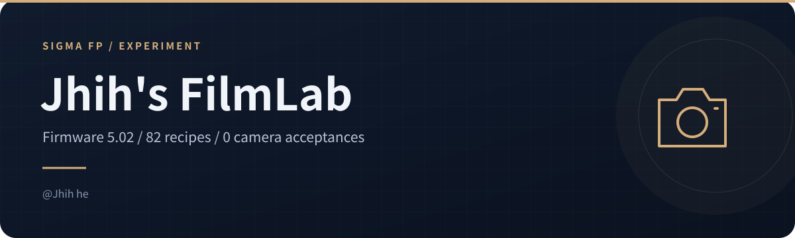
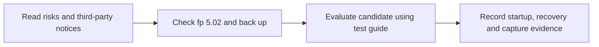

<!-- readme-visuals:header:start -->

  
  
  

<!-- readme-visuals:header:end -->

# 🎞️ Jhih’s FilmLab for Sigma fp

**Experimental in-camera film simulation recipes and color presets for Sigma fp firmware 5.02.**

**给 Sigma fp 多一点玩色彩的空间。机内色彩方案实验，非官方项目。**

[English](README.md) · [简体中文](README.zh-CN.md)

An fpSup-based experiment in switching color recipes before pressing the shutter, with a bilingual on-screen display (HUD).

> [!WARNING]
> **Experimental candidate, not an official SIGMA firmware update or a stable release. Sigma fp firmware 5.02 only; not fp L or other firmware versions.**
>
> v0.7.5 has passed offline checks only. Camera startup and stability remain unverified, and **0/82 recipes have completed individual on-camera color acceptance**. Early development builds froze during startup. Freezes, crashes, unexpected restarts, abnormal previews/photos, interrupted shooting/recording, and loss of unsaved images or data are possible. Safety and stability cannot be guaranteed.
>
> Back up your images and record your original camera settings. Test with a spare SD card and avoid important shoots. RAM loading does not mean zero risk: white balance and color settings may persist after the loader is removed.
>
> **If the camera freezes:** try switching it off first. If it does not respond, disconnect external power and remove the battery. Use a card reader to remove `AutoRun.txt` and `FilmLab.BIN` from the card root, then fully power-cycle the camera. Check and manually restore your original settings. AEL + OK is intended to restore the current startup snapshot while the program is running; this behavior still requires camera testing, and the snapshot is lost after power-off.

Real screen capture from an earlier build. It does not demonstrate v0.7.5 operation or color accuracy.

<!-- readme-visuals:overview:start -->

## At a glance

<table>
<tr>
<td width="33%"><strong>Recipe catalog</strong>  82 named recipes and 73 target parameter sets.</td>
<td width="33%"><strong>Controls and HUD</strong>  Button switching and bilingual HUD; candidate needs camera tests.</td>
<td width="33%"><strong>Evidence and limits</strong>  0/82 camera color acceptances; stock COLOR menu not shipped.</td>
</tr>
</table>

> Experimental, noncommercial project; current candidate has offline checks only. fpSup redistribution permission remains outstanding; retain the full warnings and notices below.

### Workflow overview

<!-- readme-visuals:overview:end -->

## 📷 What is FilmLab?

FilmLab explores **Sigma fp film simulation**, in-camera color presets, and JPEG recipes using the camera's existing image parameters. It uses the fpSup SD-card runtime loading approach rather than flashing the camera firmware.

- 🎨 **82 named recipes, 73 distinct target parameter sets**, ordered Hasselblad-inspired → Fujifilm-inspired → Ricoh GR-inspired → Leica-inspired → others.
- 🕹️ Button-based recipe switching, with Chinese/English names and short style descriptions in the HUD.
- 🧪 Approximate mappings for color mode, contrast, sharpness, saturation, white balance and offsets. Recipe names describe inspiration, not equivalent manufacturer processing.
- 🧭 Integration into the stock **COLOR menu is still research and is not included** in the candidate package.

| Evidence | Current status |
| --- | --- |
| Earlier v0.3.4 build | User reported changes in both preview and captured photos |
| v0.7.5 Sepia candidate | Offline checks only; camera startup and stability unverified |
| Recipe color acceptance | **0 / 82**; controlled camera captures and reference images needed |
| Stock COLOR menu integration | Not shipped |

Sony color matrices, some picture effects and Dynamic Range Optimizer (DRO) have no equivalent implementation here. Hasselblad HNCS, Fujifilm film simulations, Ricoh GR and Leica names are **style references**, not official implementations, endorsements or exact reproductions. No original SIGMA firmware image is distributed in this repository.

## 📦 Download and documentation

**[Download v0.7.5 Sepia candidate ZIP](downloads/Jhih-FilmLab-v0.7.5-sepia-candidate.zip)** · [Pre-release page](https://github.com/jhihhe/Jhih-FilmLab/releases/tag/v0.7.5-sepia-candidate)

SHA-256: `f8d2e10326063574f2b3437afb050d01cd9b0e884eb2ab918d8a743d849634ba`

The ZIP contains `AutoRun.txt`, `FilmLab.BIN` and Chinese test instructions. **English instructions are provided in this repository; the existing ZIP is unchanged.** Read the risks and test guide before deciding whether to try it.

The package contains fpSup loading code. No explicit redistribution license was found in the upstream revision used, and the upstream author's redistribution permission has **not been obtained**. This repository does not include the fpSup loader source and cannot independently build the complete installation package. See [third-party notices](NOTICE.md).

| Read next | English | 中文 |
| --- | --- | --- |
| Installation, controls and recovery | [Camera test guide](docs/native-testing.en.md) | [机内测试说明](docs/native-testing.md) |
| All 82 recipe names and target parameters | [Bilingual recipe catalog](docs/film-catalog.en.md) | [配方清单](docs/film-catalog.md) |
| Color adaptation limits | [Adaptation audit](docs/catalog-adaptation-audit.en.md) | [适配核对报告](docs/catalog-adaptation-audit.md) |
| First-party license | [English translation](LICENSE.en.md) | [中文许可](LICENSE) |

## 🕹️ Controls at a glance

For the matching candidate package, power the camera off before putting `AutoRun.txt` and `FilmLab.BIN` in the SD card root. Do **not** use the official firmware-update menu. Use the normal still-photo live view for initial tests.

| Hold AEL, then press | Intended action |
| --- | --- |
| Left / Right | Previous / next recipe; wraps around the 82-entry list |
| Up / Down | Move by ten entries |
| OK | Restore settings captured at this startup |

Release and press the direction again for another change. Stock button actions are not blocked, so avoid switching in menus or playback. Check whether AEL has been assigned to Screenshot. The two-line HUD includes Chinese brand names and English recipe names; **an English-only HUD is not implemented**. Boot, HUD rendering and restore behavior in the current candidate still need real-camera testing.

To stop loading FilmLab, switch off and remove `AutoRun.txt` and `FilmLab.BIN` using a card reader, then fully power-cycle. Check persisted settings afterward. Removing these files does not automatically undo parameter changes.

## 🤝 Follow the experiment

Questions and reports in **English or Chinese** are welcome in [Issues](https://github.com/jhihhe/Jhih-FilmLab/issues). Include your camera model, firmware, FilmLab version, recipe number and reproduction steps. Remove personal information from shared files. If you find the work useful, a **Star ⭐** helps you find future updates.

Maintainer: **`@Jhih he`**. Independent project; no official affiliation with SIGMA, Hasselblad, Fujifilm, Ricoh or Leica.

## 📜 License and credits

First-party work uses a **source-available, noncommercial license**, not an OSI-approved open-source license. See [LICENSE](LICENSE) and its [English translation](LICENSE.en.md). Commercial use requires prior written permission; this does not grant rights to third-party work.

Recipe source: [recipe-lab-sony-pmca-cn](https://github.com/jcx396905-gif/recipe-lab-sony-pmca-cn), retaining André Domingues / voxivoid's [MIT license](vendor/sony-recipe-lab/LICENSE). Loading approach: [fpSup](https://github.com/ijigen/fpSup) by ijigen; redistribution permission remains outstanding. Third-party copyrights and licenses remain separate.
